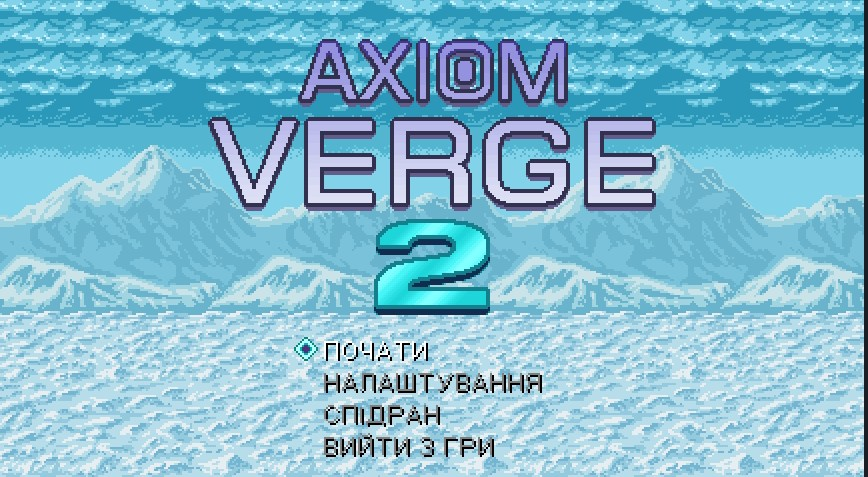
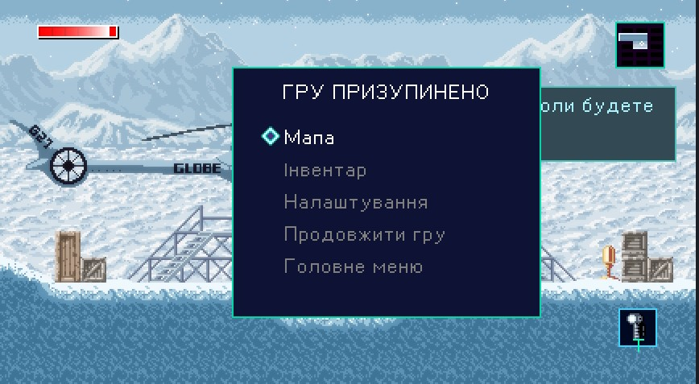
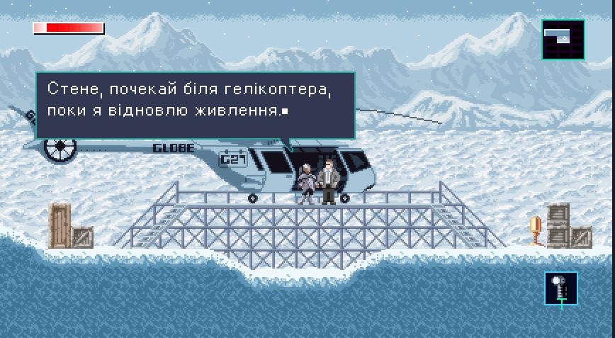

# Axiom Verge 2 — українська локалізація

[Завантажити вихідний пакет з інсталятором](AxiomVerge2-UA-source-v1.zip).

Пакет містить переклади, генератор кириличних шрифтів, установник Windows та відновлення оригінальних файлів. Він збирає патч із вашої копії гри; `AxiomVerge2.exe` та XNB-файли гри не розповсюджуються.

## Windows

Потрібні Node.js і Python 3 з командою `py`. При першому запуску потрібен інтернет для встановлення Pillow.

1. Завантажте ZIP за посиланням вище та розпакуйте його.
2. Двічі клацніть `Install-AxiomVerge2-UA.bat`.
3. Виберіть папку гри з `AxiomVerge2.exe` та підтвердьте встановлення.

Оригінали зберігаються в `UA-localization-backup`. Для відновлення запустіть `Restore-AxiomVerge2-UA.bat`.

## Linux

Потрібні Node.js, Python 3 і Pillow. Із папки проєкту виконайте:

```sh
python3 -m pip install --user -r requirements.txt
python3 install.py '/шлях/до/Axiom Verge 2'
```

Патчер підтримує лише версію гри, вказану в `supported-version.json`; для іншої версії він зупиниться без заміни файлів.







Новий пакет ще не перевірявся VirusTotal. Переклад охоплює 1 215 записів; повне проходження для редакторської вичитки не виконано.
